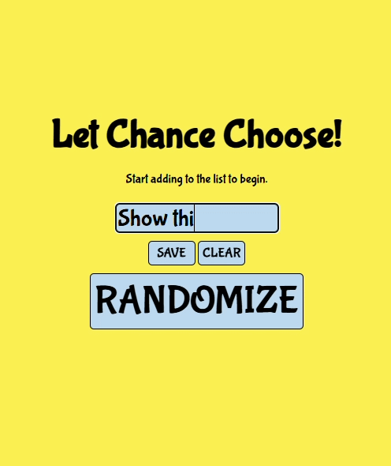
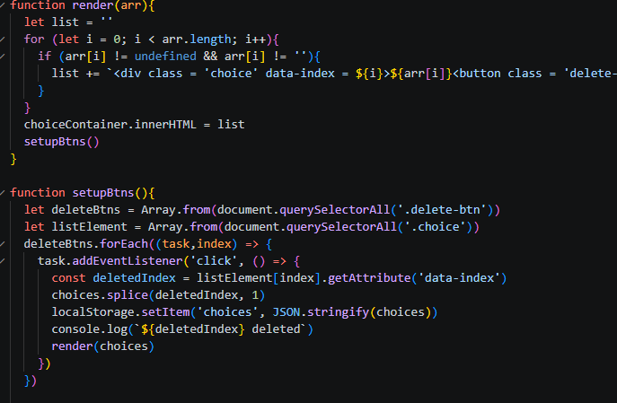
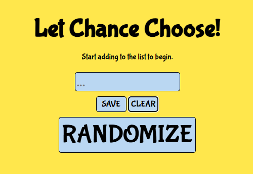

# LetChanceChoose Chrome Extension 📧

  

## The Idea 💡
I made this to solidify concepts I was learning in a full-stack developer course I was taking. I was thinking of beginning leetcode, so I wanted a program that could: 

- Create and store a list
- Select a random task from the list
- Delete elements individually or totally

## The tech stack(I think that's what it's called) 💻
As expected, I use Javascript, HTML and CSS for this. Nothing too fancy. 

## The results 📋
I deployed the project as a chrome extension which I keep at the top of my google chrome bar. I'm happy with how it turned out as it achieves everything I set out for it to do. 

 
  

